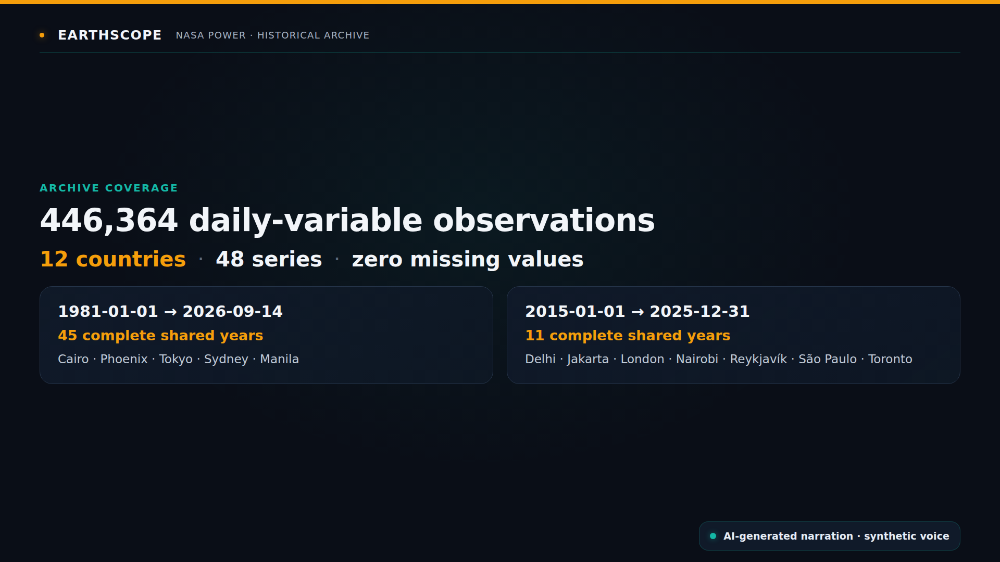

# EarthScope 30-second demo — updated storyboard

Target: 1920 × 1080, 30 fps, H.264 with AAC narration, total duration at or below 30.0 seconds. Use authentic dashboard captures and charts generated directly from the included SQLite observations and saved model evaluation. Keep the existing dark navy/teal EarthScope visual language. Do not create simulated disaster events or imply that any model predicts hazards. Disclose the synthetic narration on screen in every frame and in the MP4 metadata.

| # | Time | Frame | On-screen text | Narration |
|---|---|---|---|---|
| 1 | 0.0–2.5 | Existing EarthScope title frame, preserve credited Blue Marble context image | EARTHSCOPE · NASA POWER historical archive · 12 countries | EarthScope stores 446,364 NASA POWER observations for twelve countries. |
| 2 | 2.5–6.0 | Archive coverage frame with the 12-country list and per-group date ranges | 12 countries · 48 series · zero missing values · 45 complete years for the original five, 11 for the seven added | …twelve countries, with complete calendar years for every series. |
| 3 | 6.0–11.0 | Comparison panel capture: two countries on one shared range, annual chart plus summary rows | Shared UTC range · annual and seasonal summaries · extrema with dates · completeness warnings · descriptive trends | Compare any two on one shared range, with annual and seasonal summaries. |
| 4 | 11.0–15.5 | New chart computed from stored Cairo T2M annual means, 1981–2025 | Annual-mean slope: +0.032 °C/year (1981–2025; 45 means) · +0.093 °C/year (2016–2025; 10 means) · descriptive, not causal | Cairo's annual-mean slope is plus 0.093 degrees per year since 2016. |
| 5 | 15.5–20.5 | Model-suite evidence card with real held-out metrics and the interval result | 48 one-day models · held-out 2023–2025 · 1,096 days per series · 45 ridge, 3 persistence · 47 of 48 intervals pass calibration | Forty-eight tested models estimate one day ahead, and forty-seven show calibrated intervals. |
| 6 | 20.5–23.0 | Updated close frame, keep the synthetic-narration disclosure | Statistical estimates of four daily variables · not an operational weather forecast · not a disaster prediction · prototype thresholds are not official warnings | These are statistical estimates, not forecasts or disaster predictions. |

## Narration script

EarthScope stores 446,364 NASA POWER observations for twelve countries, with complete calendar years for every series. Compare any two on one shared range, with annual and seasonal summaries. Cairo's annual-mean slope is plus 0.093 degrees per year since 2016. Forty-eight tested models estimate one day ahead, and forty-seven show calibrated intervals. These are statistical estimates, not forecasts or disaster predictions.

## Reading-hold frames

## Sound and motion

Use one synthetic English narration track and no music so the voice remains clear on laptop speakers. Keep the disclosure chip “AI-generated narration · synthetic voice” visible on every frame, and preserve the disclosure in the MP4 comment, description, and synopsis metadata. Use static reading holds, restrained crossfades, and subtle scale drift on screenshot frames. Confirm the finished video is no longer than 30 seconds and that the full narration is audible.

## Accuracy rules for this cut

- Only the numbers in the current archive and model bundle may appear: 446,364 observations, 12 countries, 48 series, 1,096 held-out days, 45 ridge and 3 persistence selections, 47 of 48 intervals passing, +0.032 and +0.093 °C/year Cairo annual-mean slopes.
- No frame may say or imply that EarthScope forecasts weather, predicts disasters, or issues official warnings.
- Every frame keeps the synthetic-narration disclosure visible.
