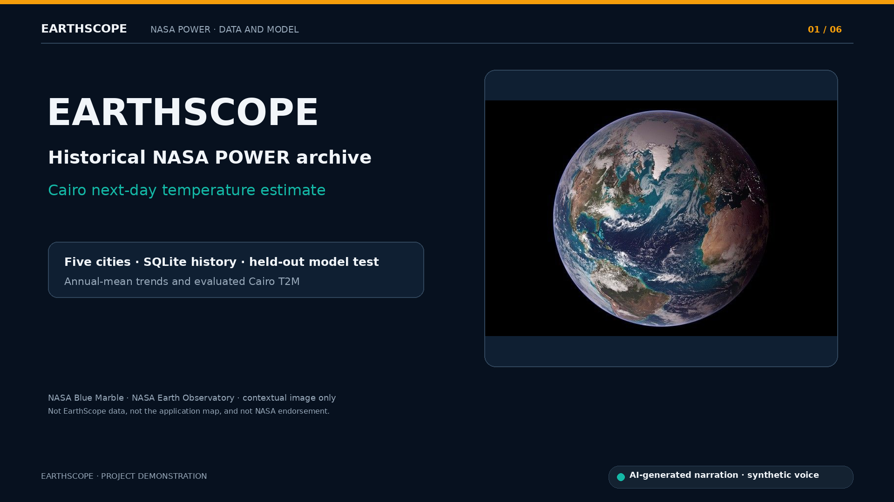
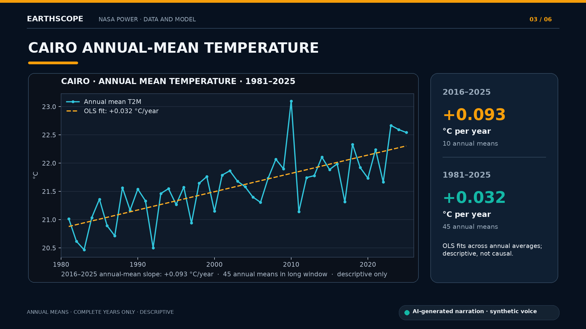
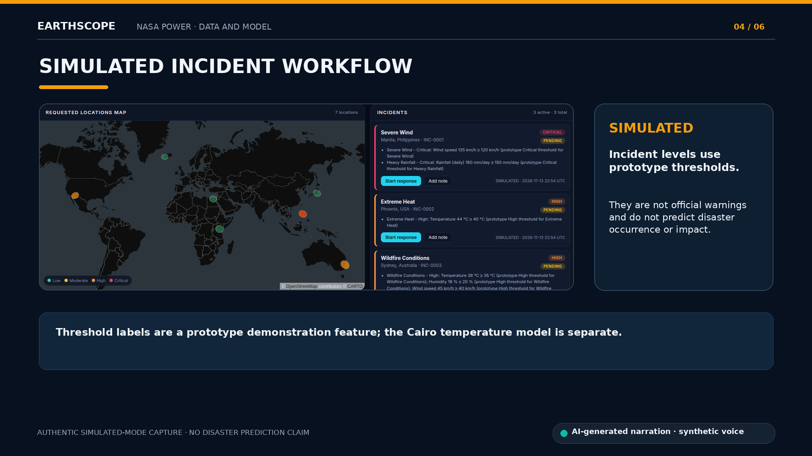
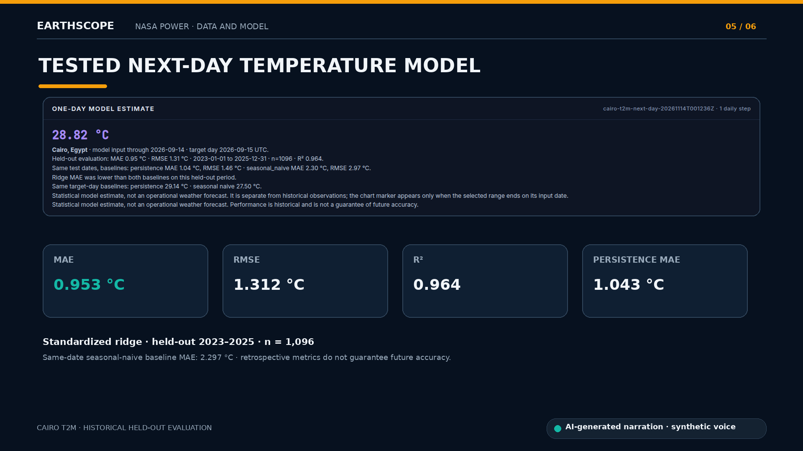
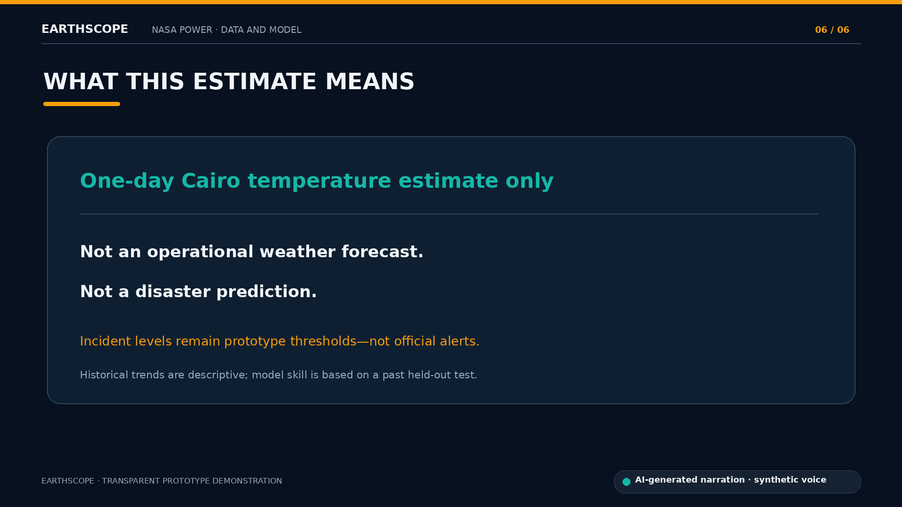

# EarthScope 30-second demo — updated storyboard

Target: 1920 × 1080, 30 fps, H.264 with AAC narration, total duration at or below 30.0 seconds. Use authentic dashboard captures and charts generated directly from the included SQLite observations and saved model evaluation. Keep the existing dark navy/teal EarthScope visual language. Do not create simulated disaster events or imply that the trained temperature model predicts hazards. Disclose the synthetic narration on screen in every frame and in the MP4 metadata.

| # | Time | Frame | On-screen text | Narration |
|---|---|---|---|---|
| 1 | 0.0–2.5 | Existing EarthScope title frame, preserve credited Blue Marble context image | EARTHSCOPE · NASA POWER historical archive · tested one-day temperature estimate | EarthScope stores NASA POWER history for five cities… |
| 2 | 2.5–6.5 | Existing authentic live dashboard capture; add a clear caption that Historical archive is also available | Five locations · four daily variables · SQLite archive · 333,860 daily-variable observations | …five cities, covering 1981 through 2026. |
| 3 | 6.5–11.0 | New chart computed from stored Cairo T2M annual means, 1981–2025 | Annual-mean slopes: +0.032 °C/year (1981–2025; 45 means); +0.093 °C/year (2016–2025; 10 means) · descriptive | Cairo annual-mean slopes: plus 0.093 degrees per year for 2016–2025; plus 0.032 for 1981–2025. |
| 4 | 11.0–13.5 | Existing authentic simulated demo map and incident panel | SIMULATED DEMO · prototype threshold incidents, not disaster predictions | Incident levels remain prototype thresholds. |
| 5 | 13.5–19.5 | New evidence card with actual held-out metrics and comparison | Cairo T2M ridge · next-day estimate · held-out 2023–2025 · n=1,096 · MAE 0.953 °C · RMSE 1.312 °C · R² 0.964 · persistence MAE 1.043 °C | A tested model estimates next-day Cairo temperature; held-out error was 0.95 degrees versus 1.04 for persistence. |
| 6 | 19.5–22.5 | Updated close frame, keep the synthetic-narration disclosure | Statistical temperature estimate only · not an operational weather forecast · not a disaster prediction | It is a statistical estimate, not an operational weather forecast or disaster prediction. |

## Narration script

EarthScope’s SQLite archive stores 333,860 NASA POWER observations across five cities, 1981 to 2026. Cairo annual-mean slopes: plus 0.093 degrees per year for 2016–2025; plus 0.032 for 1981–2025. A tested model estimates next-day Cairo temperature, with held-out error 0.95 degrees versus 1.04 for persistence. This is not an operational weather forecast or disaster prediction. Incident levels remain prototype thresholds.

## Reading-hold frames

## Sound and motion

Use one synthetic English narration track and no music so the voice remains clear on laptop speakers. Keep the existing disclosure chip “AI-generated narration · synthetic voice” visible on every frame, and preserve the disclosure in the MP4 comment, description, and synopsis metadata. Use static reading holds, restrained crossfades, and subtle scale drift on screenshot frames. Confirm the finished video is no longer than 30 seconds and that the full narration is audible.
